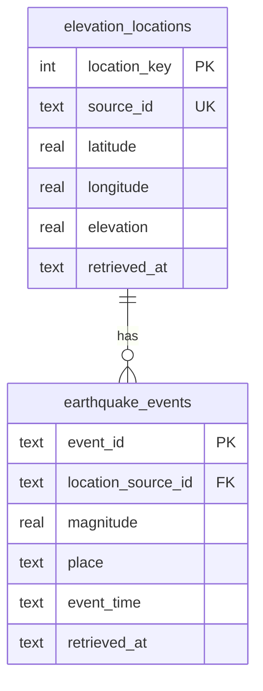
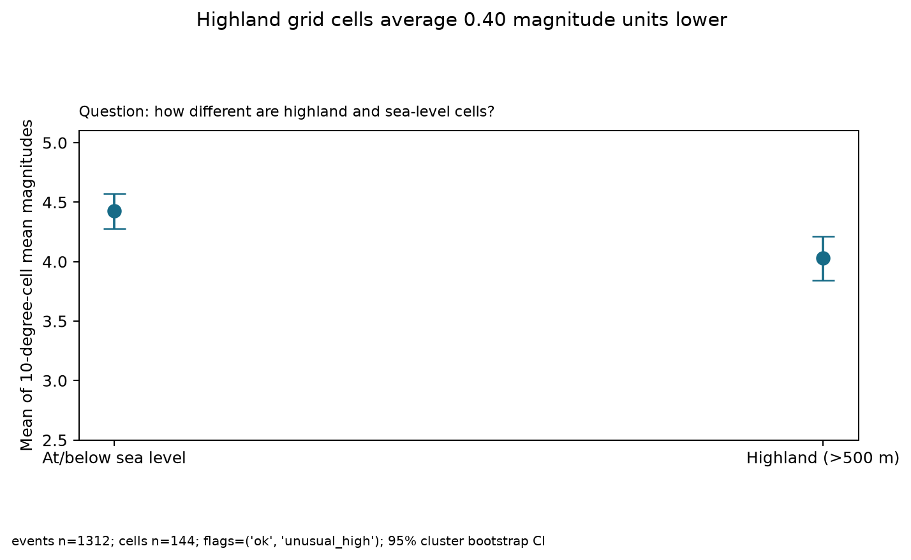

# Earthquake & Seismic Activity Tracking Pipeline

## Project Goal & Research Question

This project ingests, cleans, stores, and explores global seismic event data with elevation metadata. The core research question asks how earthquake magnitudes and frequency relate to topographical elevation and geography.

## Primary & Secondary Data Sources

- **USGS Earthquake API:** GeoJSON, global latest 1,500 events with minimum magnitude 2.5. M4 explicitly extends the original moving limit of 100 while preserving geography and threshold.
- **Open-Meteo Elevation API:** surface elevation for each unique event coordinate.

See [docs/sources.md](docs/sources.md) for source cards and the exact recovered-snapshot provenance.

## Repository Structure

```text
data/raw/                  raw API responses with UTC retrieval timestamps
docs/cleaning_report.md    M3 decisions and M4-discovered correction
docs/eda_report.md         M4 exploratory report
figures/                   six figures generated by the M4 notebook
notebooks/m3_profile.ipynb M3 profile
notebooks/m4_eda.ipynb     executable M4 analysis with saved outputs
sql/                       raw/clean schemas and analytical query
src/                       ingestion, load, clean, validation modules
tests/                     regression tests
```

## Milestone 2: Data Storage & Schema Design

SQLite `STRICT` tables enforce types, keys, and event-to-location foreign keys. The M4 correction replaces the original hardcoded İzmir relationship with a deterministic location ID for each event's real coordinate.



## Milestone 3: Data Cleaning & Quality

The clean layer preserves raw values alongside cleaned values and explicit flags. It deduplicates repeated event snapshots by event ID while keeping the latest retrieval. Details and the M4-discovered mapping correction are in [docs/cleaning_report.md](docs/cleaning_report.md).

## Exploration

The corrected 1,500-event snapshot has a mean magnitude of 3.8873 in both raw and cleaned layers. At/below-sea-level events have the highest event-weighted mean (3.991, n=1,010), while the overall magnitude-elevation relationship is weak and measure-dependent (Pearson r=0.076; Spearman rho=-0.127; n=1,500). A spatial-cell bootstrap estimates highland cells 0.396 magnitude units below sea-level cells (95% CI -0.629 to -0.167). This remains exploratory because the moving window covers only 2026-10-22 through 2026-11-15 UTC, surface elevation is not earthquake depth, and events are spatially clustered.



Read the complete [M4 exploratory analysis report](docs/eda_report.md).

### Reproduce from a fresh clone with landed raw data

Create and activate a virtual environment, install `requirements.txt`, then run:

```bash
python src/load.py
python src/clean.py
python src/validate.py
jupyter nbconvert --to notebook --execute --inplace notebooks/m4_eda.ipynb
python -m pytest -q
```

The notebook opens SQLite in immutable read-only mode, defines major parameters in its first code cell, regenerates every figure, and verifies the database SHA-256 hash is unchanged.

**Status: M4 - exploratory analysis complete.**
