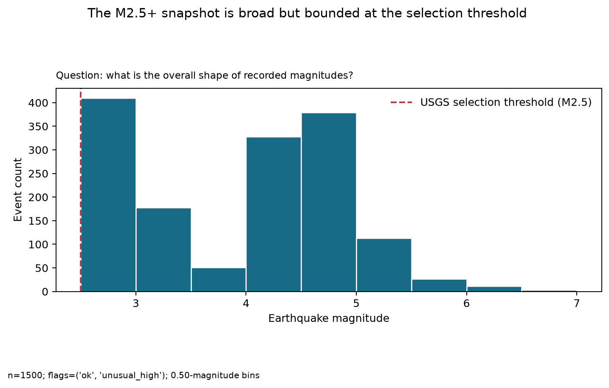
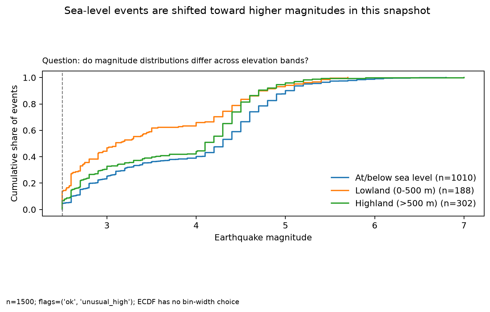
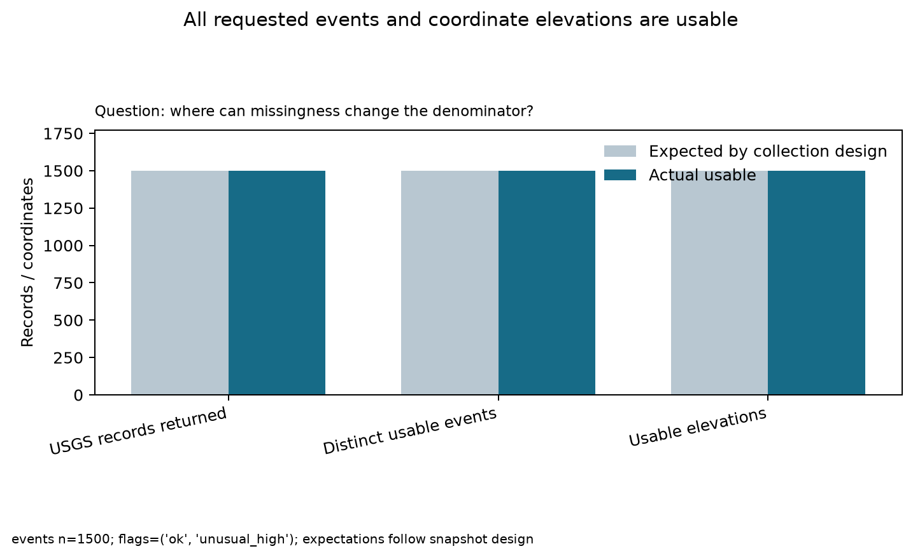
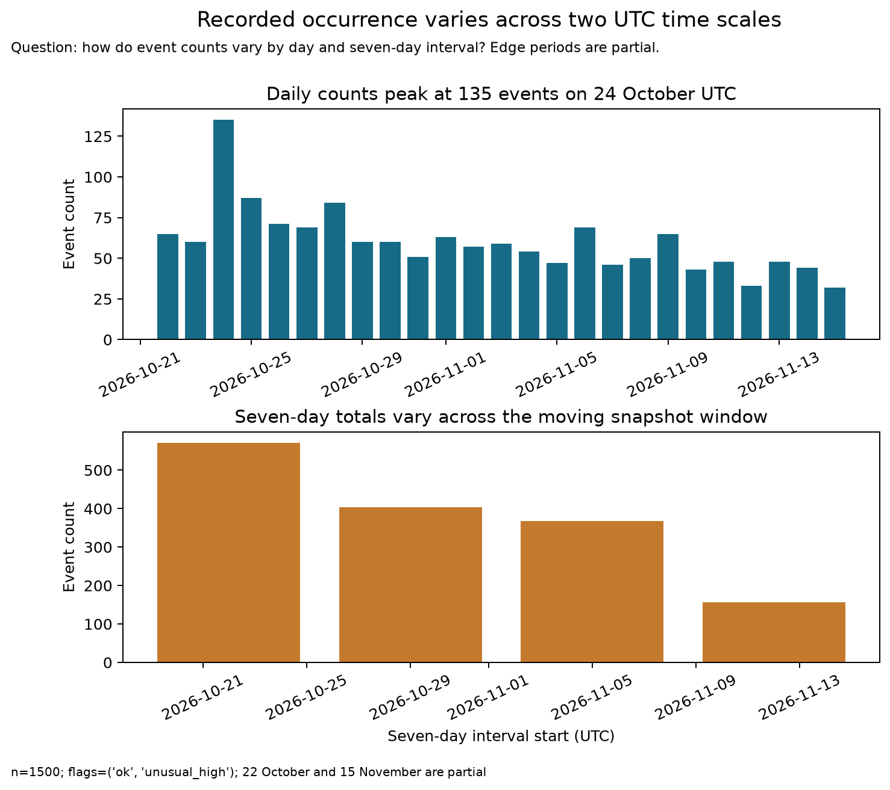
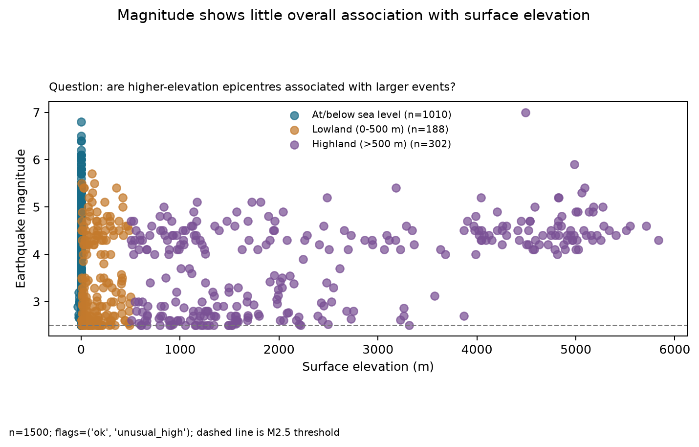
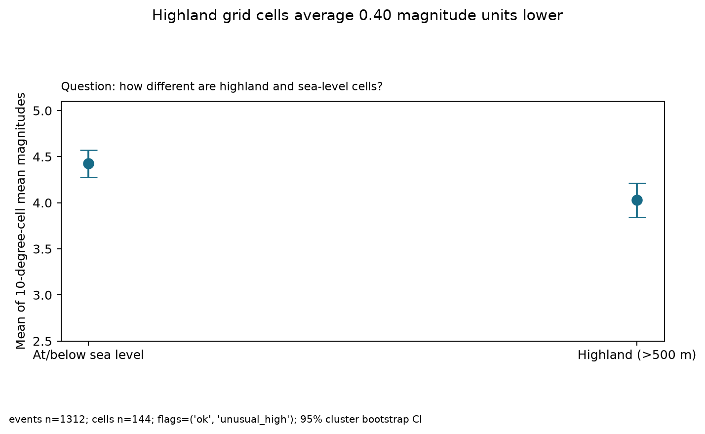

# Exploratory Analysis - Earthquake & Seismic Activity Tracking Pipeline

## 1. Summary

The project asks how earthquake magnitude and frequency relate to topographical elevation and geography in a global USGS feed. M0/M1 defined a global, moving snapshot of earthquakes at magnitude 2.5 or greater but encoded no fixed start or end date. To satisfy M4's minimum dataset size, the request limit was explicitly extended from the latest 100 to the latest 1,500 events; geography and magnitude scope were unchanged. The corrected snapshot was retrieved at 2026-11-15 16:16:20 UTC and spans events from 2026-10-22 08:34:19 to 2026-11-15 15:52:42 UTC.

The mean magnitude is 3.8873 in both the raw M2 table and cleaned M3 layer (n=1,500 each). At/below-sea-level events have the highest event-weighted mean (3.991, n=1,010), followed by highland events (3.793, n=302) and lowland events (3.482, n=188); medians give the same ranking. Overall linear and rank associations differ in sign and remain weak (Pearson r=0.076; Spearman rho=-0.127; n=1,500), while sensitivity and subgroup checks show instability. A spatial-cell bootstrap estimates that highland cells average 0.396 magnitude units below at/below-sea-level cells (95% CI -0.629 to -0.167; 55 versus 89 cells). All findings remain exploratory because the moving window, clustering, and elevation measurement constrain generalization.

Before analysis, the hardcoded İzmir mapping in `src/load.py` was repaired. Every event now retains its real coordinate and receives matching Open-Meteo elevation through a deterministic location ID. The notebook opens SQLite through an immutable read-only URI; its SHA-256 hash is identical before and after execution.

## 2. Raw versus cleaned

Mean magnitude is the key number because it answers the average-severity part of the research question while using all selected observations. The raw M2 query is:

```sql
SELECT COUNT(*) AS n, AVG(magnitude) AS mean_magnitude
FROM earthquake_events;
```

It returns **n=1,500** and **mean=3.8873**. The parameterized cleaned query uses `ok` and `unusual_high`:

```sql
SELECT COUNT(*) AS n, AVG(magnitude) AS mean_magnitude
FROM earthquake_events_clean
WHERE magnitude_flag IN (?, ?);
```

It also returns **n=1,500** and **mean=3.8873**, a difference of 0.0000. Equality is a result, not evidence that cleaning is unnecessary. The clean layer selects the latest retrieval per event ID and explicitly handles missing or outside-scope magnitudes. This single preserved snapshot has no duplicate event IDs or rejected magnitudes.

## 3. The question and its summary

The research question is: **In the global latest-1,500 USGS snapshot of M2.5+ events, how do earthquake magnitude and frequency vary with topographical elevation and geography?** Mean magnitude by fixed elevation band is primary because the question concerns average recorded severity. The median is a robust alternative because large events can move a mean.

| Elevation band | n | Mean | Median | Maximum | Mean rank | Median rank |
|---|---:|---:|---:|---:|---:|---:|
| At/below sea level | 1,010 | 3.991 | 4.3 | 6.8 | 1 | 1 |
| Lowland (0-500 m) | 188 | 3.482 | 3.1 | 5.7 | 3 | 3 |
| Highland (>500 m) | 302 | 3.793 | 4.1 | 7.0 | 2 | 2 |

Mean and median rankings agree. The bands are fixed categories rather than sample quantiles. However, zero metres for an offshore epicentre represents modeled surface elevation, not seafloor elevation or hypocentral depth.

## 4. What the data is made of

Magnitude ranges from 2.5 to 7.0, the 90th percentile is 5.0, and skewness is -0.035. Bin widths 0.25, 0.50, and 1.00 produce approximately 18, 9, and 5 bins. The Freedman-Diaconis suggestion is 0.297. A 0.50-unit width was retained because it is interpretable, close enough to the data-driven scale, and less noisy than quarter-unit bins.



The hard lower edge is imposed by the M2.5 API threshold. Consequently, this distribution is conditional on selection and cannot characterize smaller earthquakes. The ECDF avoids histogram bin-edge sensitivity and shows the sea-level group shifted toward larger magnitudes.



Coverage follows the event collection design, not a fictitious hourly schedule. The API returned all 1,500 requested records. They are 1,500 distinct usable events. There are 1,499 unique coordinates because two genuine events share one coordinate; every unique coordinate has usable elevation.

| Coverage component | Actual | Expected | Coverage |
|---|---:|---:|---:|
| USGS records returned | 1,500 | 1,500 request limit | 100% |
| Distinct usable events | 1,500 | 1,500 distinct loaded events | 100% |
| Usable elevations | 1,499 | 1,499 unique coordinates | 100% |



Overall band summaries require n>=10 and 90% elevation coverage; all bands pass. Daily-by-band summaries require n>=5: four of 75 cells are marked too thin, with the smallest containing two events. Filters `ok` only and `ok + unusual_high` both return n=1,500 and mean 3.8873 because every magnitude is `ok`. The inclusive filter is selected because an unusual high value would remain scientifically valid.

## 5. Time

UTC is used consistently because USGS supplies UTC timestamps. The first day begins at 08:34 and the last ends at 15:52, making both partial; the intervening 23 dates are complete. Daily counts peak at 135 on 24 October. Seven-day totals beginning 22 October, 29 October, 5 November, and 12 November are 571, 404, 368, and 157, but the first and last seven-day bins are partial.



Bars avoid interpolating between event-count periods. The approximately 24.3-day window supports daily and seven-day description but not monthly, seasonal, holiday, or long-run-rate conclusions. Variation can reflect earthquake sequences and the moving latest-1,500 boundary rather than a calendar mechanism.

## 6. Relationships

The scatter plot is inspected before coefficients. It shows a dense concentration near zero metres and no simple overall slope.



For all events, Pearson r=0.076 and Spearman rho=-0.127 (n=1,500). Removing the highest 2.5% of elevations gives r=0.004 and rho=-0.173 (n=1,462). Removing the largest 10-degree cell gives r=0.147 and rho=-0.035 (n=1,308). Within bands, Pearson/Spearman values are 0.108/0.097 at/below sea level (n=1,010), 0.030/0.044 in lowlands (n=188), and 0.497/0.413 in highlands (n=302).

The sign difference between Pearson and Spearman and movement under sensitivity checks show that no stable universal coefficient has been identified. The highland within-band association may reflect geographic composition or sequences. Surface elevation omits hypocentral depth, bathymetry, geology, and fault distance. Correlation cannot establish causation.

## 7. The comparison

The chosen comparison is highland versus at/below-sea-level mean magnitude. Three pairwise elevation-band comparisons were inspected. To reduce false precision from clustered events, observations are averaged within 10-degree latitude-longitude cells and 20,000 bootstrap replicates resample cells within each band.

There are 302 highland events in 55 cells and 1,010 sea-level events in 89 cells. The cell-weighted difference (highland minus sea level) is **-0.396**, with a **95% bootstrap interval from -0.629 to -0.167**.



The event-weighted difference is smaller at -0.198, showing that spatial composition matters. Sea-level daily means exceed highland means on 18 of 25 dates, while seven dates reverse direction. There is no complete Simpson reversal, but temporal heterogeneity cautions against treating the pooled contrast as constant. The grid is approximate, boundaries are arbitrary, 144 cells remain spatially dependent, and the interval does not adjust for examining three comparisons.

## 8. Findings

Contributor names are verified from Git history. The team must confirm the final `Explored by` allocation after reviewing and being able to defend each result.

| ID | Finding | Evidence | Label | What would change it | Explored by |
|---|---|---|---|---|---|
| F-01 | Raw and cleaned mean magnitude are both 3.8873 (n=1,500). | Section 2 SQL | Exploratory | A later snapshot with duplicates or invalid values | Aysima Tatlı |
| F-02 | Sea-level events have the highest mean and median magnitude. | Group table and ECDF | Exploratory | A fixed longer window or bathymetric elevation | Aysima Tatlı |
| F-03 | Overall magnitude-elevation association is weak and sensitivity-dependent. | Scatter and correlation tables | Exploratory | More windows, depth/fault controls, stable sensitivity results | Umut Şiar Demir |
| F-04 | Highland cells average 0.396 units below sea-level cells (95% CI -0.629 to -0.167). | Bootstrap comparison | Exploratory | Different grid, window, or spatial model | Yaşar Kaki |

### Back to cleaning

- The hardcoded İzmir mapping was replaced with coordinate-derived identities and protected by a regression test.
- No missing critical fields, duplicate event IDs, invalid coordinates, outside-scope magnitudes, or elevation sentinels occur.
- Zero-metre marine elevation remains a measurement limitation rather than silently becoming missing.

### Forward to modelling

- Collect fixed, longer windows and add depth, plate/fault distance, and bathymetry.
- Use sequence-aware spatial blocks to prevent aftershock leakage.
- Model the M2.5 threshold and moving latest-1,500 selection explicitly.

## 9. What we cannot say

This analysis cannot establish causation, long-run global frequency, seasonality, holiday effects, or a stable elevation-magnitude relationship. It excludes earthquakes below M2.5, covers about 24.3 days, and uses surface elevation at epicentres. Fault locations and earthquake depth are absent. The bootstrap interval quantifies resampling variability under chosen cells; it does not remove selection bias, measurement error, spatial dependence, sequence clustering, or the exploratory choice among three comparisons.

Independent fixed-window replications would be required before treating any reported group difference as a persistent feature of global seismicity.
